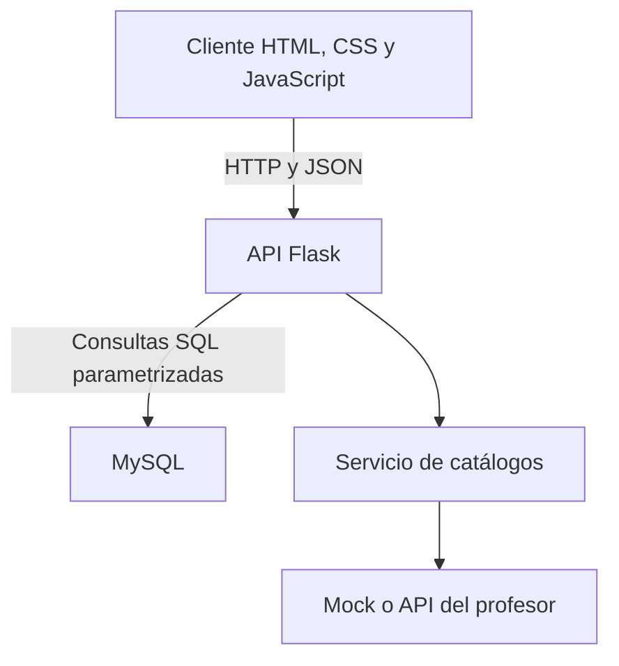

# Portfolio de proyectos y desarrolladores

## Documentación general y etapas de desarrollo

**Asignatura:** Proyecto Informático.  
**Institución:** Universidad Provincial del Sudoeste.  
**Año:** 2026.  
**Fecha de corte de esta documentación:** 15/11/2026.

| Dato del grupo |  |
|---|---|
| Integrantes | González, Matías Gabriel - Badano, María Xiomara |
| Project Manager | González, Matías Gabriel |
| Repositorio privado | https://github.com/xNeoMATRIXx/Trabajo-Final-UPSO-2026 |
| Versión de entrega | Rama `main` |


## 1. Presentación del proyecto

El sistema permite a desarrolladores registrar y publicar un portfolio profesional. Cada usuario administra sus datos personales, las habilidades técnicas que posee y los proyectos en los que trabajó o está trabajando.

La aplicación separa una zona privada de administración y una vista pública de consulta. Las operaciones privadas requieren autenticación, mientras que cualquier visitante puede consultar un portfolio publicado sin iniciar sesión.

El diseño responde al modelo SaaS multiusuario solicitado: varias personas utilizan una misma aplicación y una misma base de datos, con aislamiento de las operaciones sobre los datos de cada cuenta. En este proyecto la propiedad de los recursos se representa mediante `usuario_id`; no existe una entidad adicional de empresa u organización.

### 1.1. Objetivo general

Desarrollar una aplicación web con API REST y persistencia SQL que permita administrar portfolios de desarrolladores, mantener el aislamiento entre usuarios y utilizar un catálogo centralizado de lenguajes y tecnologías.

### 1.2. Objetivos específicos

- Permitir registro, inicio de sesión y administración del perfil propio.
- Registrar lenguajes y tecnologías como habilidades, indicando el nivel de dominio.
- Administrar proyectos con etapa, fechas, lenguajes, tecnologías y enlaces externos.
- Publicar un portfolio accesible sin autenticación.
- Validar la pertenencia de cada recurso antes de modificarlo o eliminarlo.
- Consumir los catálogos del profesor a través del backend, manteniéndolos de solo lectura.
- Verificar la API mediante una colección REST y documentar las decisiones y etapas del desarrollo.

### 1.3. Alcance funcional

El proyecto se concentra en cuentas de desarrolladores, habilidades, proyectos, catálogos y portfolios públicos.

## 2. Requisitos y criterios de aceptación

| Área | Criterio de aceptación |
|---|---|
| Tecnologías | Backend en Python con Flask y `mysql-connector-python`; persistencia SQL; cliente con HTML, CSS y JavaScript puro. |
| Autenticación | Registro e inicio de sesión con contraseña; emisión y validación de JWT para operaciones privadas. |
| Aislamiento | Una cuenta puede administrar únicamente sus propios datos, habilidades y proyectos. |
| Perfil | Consulta y edición de los datos personales de la cuenta autenticada. |
| Habilidades | Registro, consulta, cambio de nivel y eliminación de lenguajes y tecnologías existentes en el catálogo. |
| Proyectos | Alta, consulta, edición y eliminación de proyectos propios. |
| Relaciones de proyectos | Como mínimo un lenguaje y una tecnología por proyecto, en creación y edición. |
| Enlaces | Múltiples enlaces por proyecto, incluso del mismo tipo. |
| Fechas | Creación y actualización; finalización y deadline cuando correspondan. |
| Catálogos | Recursos `GET /lenguajes` y `GET /tecnologias`, sin altas, modificaciones ni bajas. Fuente final: API del profesor. |
| Publicación | Perfil, habilidades y proyectos visibles sin token, sin exponer credenciales. |
| Validaciones | Rechazo de tipos, IDs y cuerpos incorrectos con errores controlados en JSON. |
| Pruebas | Colección REST con casos válidos, inválidos, duplicados, autenticación e intentos de acceso entre usuarios. |
| Documentación | Etapas, diseño, UML, instalación, funcionamiento y pruebas. |
| Gestión | Repositorio privado, control de versiones y coordinación mediante un Project Manager. |


## 3. Arquitectura del sistema

### 3.1. Componentes

| Componente | Responsabilidad |
|---|---|
| Cliente web | Presentar formularios y portfolios, validar entradas y consumir la API mediante peticiones HTTP. |
| API Flask | Autenticar, autorizar, validar, ejecutar reglas de negocio y devolver JSON. |
| Base de datos MySQL | Persistir cuentas, habilidades, proyectos y relaciones. |
| Servicio de catálogos | Obtener, normalizar y mantener temporalmente en caché los lenguajes y tecnologías. |
| Fuente de catálogos | Mock durante el desarrollo; API del profesor cuando esté disponible y adaptada. |



El navegador consulta los catálogos mediante la API del grupo. La selección de la fuente se resuelve en el backend, de modo que el cliente no necesita conocer la dirección ni las credenciales del proveedor externo.

### 3.2. Organización del código


| Archivo o directorio | Función |
|---|---|
| `backend/app.py` | Crear la aplicación Flask, registrar blueprints y manejadores de errores. |
| `backend/config.py` | Centralizar la configuración mediante variables de entorno. |
| `backend/models/database.py` | Gestionar conexiones, cursores y transacciones de MySQL. |
| `backend/routes/__init__.py` | Compartir autenticación y validaciones de entrada. |
| `backend/routes/auth.py` | Registro, login y operaciones sobre la cuenta propia. |
| `backend/routes/skills.py` | Administración de habilidades de ambos catálogos. |
| `backend/routes/projects.py` | Administración de proyectos y persistencia de relaciones. |
| `backend/routes/catalog.py` | Exponer los catálogos de solo lectura. |
| `backend/routes/public.py` | Construir la respuesta pública de un portfolio. |
| `backend/services/catalog_service.py` | Adaptar y consultar la fuente de catálogos. |
| `backend/data/catalogo_prueba.json` | Datos provisionales para el modo mock. |
| `backend/mock_catalogo.py` | Servidor HTTP de prueba para simular la API externa. |
| `backend/sql/schema.sql` | Definir el esquema de base de datos para una instalación nueva. |
| `backend/sql/002_habilidades_lenguajes.sql` | Migrar el diseño anterior de habilidades. |
| `frontend/index.html` | Vistas de acceso y panel privado. |
| `frontend/public.html` | Vista pública del portfolio. |
| `frontend/js/main.js` | Comunicación con la API y comportamiento del panel. |
| `frontend/css/styles.css` | Presentación visual de la aplicación. |

### 3.3. Aplicación de programación orientada a objetos

La aplicación combina funciones de rutas Flask con clases para responsabilidades compartidas. `Config` reúne la configuración; `Database` administra un pool de conexiones; `Cursor` implementa un administrador de contexto para commit, rollback y cierre. `CatalogService` encapsula el acceso a los catálogos y `CatalogSnapshot` representa una instantánea normalizada.

El uso de esas clases no implica que todas las entidades del dominio estén implementadas como clases Python. Los diagramas de tablas documentan el modelo de datos y no sustituyen un diagrama de las clases del código.

## 4. Modelo de datos

6 tablas y 28 columnas.

| Tabla | Responsabilidad | Clave primaria |
|---|---|---|
| `usuarios` | Identidad, datos de perfil y hash de contraseña. | `id` |
| `habilidades` | Relacionar un usuario con un lenguaje o una tecnología y su nivel. | (`usuario_id`, `tipo`, `elemento_id`) |
| `proyectos` | Datos y fechas de los proyectos de cada usuario. | `id` |
| `proyecto_lenguaje` | Asociar proyectos con lenguajes externos. | (`proyecto_id`, `lenguaje_id`) |
| `proyecto_tecnologia` | Asociar proyectos con tecnologías externas. | (`proyecto_id`, `tecnologia_id`) |
| `proyecto_links` | Guardar los enlaces externos de cada proyecto. | `id` |

### 4.1. Relaciones e integridad

`usuarios` se relaciona con `habilidades` y `proyectos` mediante relaciones uno a muchos. `proyectos` se relaciona con sus filas de lenguajes, tecnologías y enlaces también mediante relaciones uno a muchos. Las cinco claves foráneas locales utilizan `ON DELETE CASCADE`.

Las relaciones de proyectos con catálogos representan asociaciones muchos a muchos. En habilidades, `tipo` identifica el catálogo al que pertenece `elemento_id`; un mismo número puede existir en ambos catálogos sin representar el mismo elemento.

No existen tablas locales `lenguajes`, `tecnologias` o `categorias`. Por eso `lenguaje_id`, `tecnologia_id` y `elemento_id` no tienen claves foráneas SQL hacia catálogos. Su validez se comprueba en el backend.

La exigencia de al menos un lenguaje y una tecnología por proyecto es una regla de la aplicación. El esquema por sí solo permite que un proyecto no tenga filas en alguna de sus tablas de relación.

### 4.2. Enumeraciones

| Campo | Valores almacenados |
|---|---|
| Tipo de habilidad | `lenguaje`, `tecnologia` |
| Nivel de dominio | `basico`, `intermedio`, `avanzado` |
| Etapa de proyecto | `formulacion`, `modelado`, `implementacion`, `testing`, `produccion`, `mantenimiento` |
| Tipo de enlace | `repositorio`, `demo`, `documentacion`, `video`, `otro` |

### 4.3. Fechas y campos opcionales

`created_at`, `fecha_creacion` y `fecha_actualizacion` son `TIMESTAMP` que admiten `NULL` y tienen `CURRENT_TIMESTAMP` como valor por defecto. `fecha_actualizacion` también tiene actualización automática. El endpoint de edición trabajado asigna explícitamente una nueva marca para cubrir modificaciones realizadas solo sobre relaciones.

`fecha_finalizacion` y `fecha_deadline` son `DATE` opcionales. También se admite que la descripción del proyecto sea nula.

## 5. Etapas de desarrollo

### Etapa 1. Análisis de la consigna y del avance inicial

**Trabajo realizado.** Se revisaron las consignas y los requisitos. Se crearon las entidades iniciales, el backend y el frontend.

### Etapa 2. Preparación del entorno local

**Trabajo realizado.** Se trabajó sobre el entorno virtual de Python, la instalación de dependencias, la configuración del backend y el inicio de MySQL desde Laragon.

### Etapa 3. Código base del backend

**Trabajo realizado.** Se crearon y probaron las funcionalidades básicas del backend, utilizando datos hardcodeados en json como mock de la API.

### Etapa 4. Código base de frontend y UI

**Trabajo realizado.** Se crearon las funciones de frontend y se construyó la UI con HTML y CSS.

### Etapa 5. Creación de mock API

**Trabajo realizado.** Para mejorar las pruebas y avanzar en un entorno más cercano al objetivo, se creó una versión mock de la API para suplirla hasta tener acceso a la del profesor.

### Etapa 6. Diseño de la persistencia y relaciones

**Trabajo realizado.** Se revisaron las tablas, claves compuestas, restricciones únicas y borrados en cascada. Para admitir habilidades de ambos catálogos se preparó la migración desde `tecnologia_id` hacia la combinación `tipo` y `elemento_id`, conservando los registros anteriores como tecnologías.

### Etapa 7. API REST, autenticación y aislamiento

**Trabajo realizado.** Se revisaron las rutas de registro, login, habilidades, proyectos y consulta pública. La autenticación utiliza JWT y la contraseña se almacena como hash bcrypt. Las operaciones privadas obtienen el propietario desde el token y filtran las consultas SQL por ese identificador.

### Etapa 8. Completar habilidades, proyectos y perfil

**Trabajo realizado.** Se incorporó la distinción entre habilidades de lenguaje y tecnología con nivel de dominio; se exigió una selección mínima de ambos catálogos en proyectos; y se agregó la edición del perfil propio mediante `PUT /auth/me` y un formulario privado. Se separaron las responsabilidades de consultar el perfil con GET y actualizarlo con PUT.

### Etapa 9. Validaciones y mejoras de interacción

**Trabajo realizado.** Se detallaron validaciones de tipos, tamaños, listas, enumeraciones, IDs y fechas, con errores 400 en JSON. Se preparó el bloqueo del botón Guardar mientras se procesa una petición. También se trabajó la visualización de fechas sin desplazamientos de día y la actualización explícita de la marca temporal de proyectos cuando cambian solo sus relaciones.

### Etapa 10. Pruebas de API y datos de demostración

**Trabajo realizado.** Se generó una colección Bruno de 92 peticiones con casos válidos e inválidos, duplicados, tokens, aislamiento, relaciones y cambios de fecha de actualización. Los scripts generan dos usuarios de prueba con identificadores únicos y capturan automáticamente IDs y tokens.

### Etapa 11. Documentación y UML

**Trabajo realizado.** Se elaboraron diagramas físicos y lógicos, se contrastaron con la exportación real y se documentaron claves, cardinalidades y reglas.

### Etapa 12. Integración oficial y cierre de entrega

**Objetivo.** Presentar una versión reproducible que utilice los catálogos oficiales y tenga evidencias completas.

**Trabajo pendiente.** Adaptar la API del profesor; verificar IDs y categorías; ejecutar la colección contra MySQL; realizar pruebas del cliente; preparar dos portfolios completos; y completar responsables, repositorio y versión de entrega en la documentación.

**Resultado esperado.** Una versión del proyecto cuyos requisitos se puedan demostrar mediante la aplicación, la colección REST, los datos de prueba y los documentos del equipo.

**Estado.** Pendiente de cierre.

## 6. API REST de la versión trabajada

Las operaciones privadas utilizan `Authorization: Bearer <token>`.

| Método | Recurso | Autenticación | Función |
|---|---|---|---|
| GET | `/` | No | Consultar el estado básico de la API. |
| POST | `/auth/register` | No | Registrar una cuenta y obtener sesión. |
| POST | `/auth/login` | No | Autenticar mediante email y contraseña. |
| GET | `/auth/me` | Sí | Consultar el perfil propio. |
| PUT | `/auth/me` | Sí | Actualizar email, username, nombre y bio propios. |
| DELETE | `/auth/me` | Sí | Eliminar la cuenta propia. |
| GET | `/lenguajes` | No | Consultar lenguajes disponibles. |
| GET | `/tecnologias` | No | Consultar tecnologías y sus categorías. |
| GET | `/habilidades` | Sí | Listar habilidades propias. |
| POST | `/habilidades` | Sí | Agregar una habilidad de un catálogo. |
| PUT | `/habilidades/<tipo>/<element_id>` | Sí | Actualizar el nivel de una habilidad propia. |
| DELETE | `/habilidades/<tipo>/<element_id>` | Sí | Eliminar una habilidad propia. |
| GET | `/proyectos` | Sí | Listar proyectos propios y sus relaciones. |
| POST | `/proyectos` | Sí | Crear un proyecto. |
| PUT | `/proyectos/<project_id>` | Sí | Editar un proyecto propio. |
| DELETE | `/proyectos/<project_id>` | Sí | Eliminar un proyecto propio. |
| GET | `/u/<username>` | No | Consultar un portfolio público. |

`PUT /auth/me` requiere email y username en el contrato trabajado; no implementa una actualización parcial genérica. El propietario no puede elegirse enviando otro ID en el cuerpo. La edición de proyectos también utiliza el objeto completo requerido por su validador.

Los catálogos no ofrecen POST, PUT ni DELETE.

### 6.1. Respuestas y errores

| Código | Uso previsto |
|---|---|
| 200 | Consulta o modificación correcta; también eliminaciones con respuesta JSON. |
| 201 | Creación correcta. |
| 400 | Entrada inválida, JSON incorrecto, tipos o IDs rechazados. |
| 401 | Token ausente, inválido o vencido; credenciales incorrectas. |
| 404 | Usuario o recurso no encontrado dentro del ámbito de consulta autorizado. |
| 405 | Método no permitido, por ejemplo POST sobre catálogos. |
| 409 | Duplicado de email, username o habilidad. |
| 503 | Catálogo no disponible o respuesta externa no utilizable cuando se requiere obtenerlo. |

Un ID de ruta que no coincide con el convertidor entero de Flask puede devolver 404 antes de entrar al validador. Los errores internos reales no deben transformarse indiscriminadamente en 400.

## 7. Validaciones y reglas de seguridad

### 7.1. Validaciones compartidas

El backend espera objetos JSON y rechaza cuerpos mal formados o de otro tipo. Los IDs se validan como enteros positivos dentro del rango admitido; no se aceptan automáticamente strings, decimales o booleanos como identificadores.

Se verifican los tipos antes de consultar conjuntos de valores permitidos o de ejecutar operaciones de texto. Las consultas utilizan parámetros SQL para los valores recibidos.

### 7.2. Validaciones del dominio

| Recurso | Reglas principales |
|---|---|
| Cuenta | Formato y longitud de email; username permitido y único; contraseña válida para el contrato de bcrypt; nombre y bio con límites. |
| Perfil | Solo campos permitidos; unicidad excluyendo la cuenta propia; identidad obtenida del token. |
| Habilidad | Tipo y nivel permitidos; ID válido del catálogo correspondiente; no repetir la misma combinación para un usuario. |
| Proyecto | Nombre no vacío y hasta 160 caracteres; etapa permitida; fechas válidas; listas correctas con al menos un elemento de cada catálogo. |
| Enlace | Tipo permitido; texto de URL no vacío y hasta 500 caracteres. La validación de un esquema de URL específico no debe darse por implementada sin revisar el código final. |

La validación del formulario mejora la interacción, pero no sustituye la comprobación del backend. El comportamiento debe mantenerse aunque la petición se envíe directamente desde Bruno.

### 7.3. Sesión y publicación

El cliente trabajado guarda datos de sesión en `localStorage`. Las peticiones privadas incluyen el token; la vista pública no lo necesita. La respuesta pública omite el email y el hash de contraseña, y no contiene tokens.

El cierre de sesión del cliente borra la sesión almacenada localmente. No se documenta como un sistema de revocación de JWT en el servidor. La configuración revisada utiliza HS256 y una duración configurable del token.

## 8. Catálogos: desarrollo e integración final

### 8.1. Modos de funcionamiento

| Modo | Comportamiento |
|---|---|
| `mock` | Lee el catálogo provisional de un archivo JSON local. |
| `http` con mock HTTP | Consulta el servidor de prueba para ejercitar comunicación y adaptación. |
| `http` con API oficial | Consultará la fuente del profesor cuando se disponga del contrato real y se complete su adaptación. |

El adaptador actual normaliza lenguajes con `id` y `nombre`, y tecnologías con `id`, `nombre` y `categoria`. Ese formato es provisional respecto del proveedor oficial. Los IDs del mock no se consideran equivalentes a los IDs reales.

### 8.2. Caché y disponibilidad

El servicio utiliza una caché en memoria con duración configurable y una instantánea coherente por petición. El valor inicial trabajado es de 300 segundos y el timeout HTTP de 5 segundos.

Mientras la caché es válida puede atenderse una consulta desde ella. Cuando se necesita renovarla y la fuente falla, el backend devuelve un error controlado. En modo HTTP no se sustituye silenciosamente la fuente oficial por datos mock ni se presenta una caché vencida como si estuviera actualizada.

### 8.3. Pasos para integrar la API del profesor

1. Obtener la URL, autenticación, rutas y ejemplos de respuestas de ambos catálogos.
2. Adaptar la normalización de lenguajes, tecnologías y categorías al contrato real, incluyendo paginación si la hubiera.
3. Verificar unicidad, tipos y estabilidad de los identificadores.
4. Configurar el modo HTTP y ejecutar las consultas de catálogo a través de la API del grupo.
5. Revisar los datos de prueba existentes: eliminar y recrear datos mock o preparar un mapeo explícito, sin asumir equivalencia de IDs.
6. Probar habilidades y proyectos con IDs oficiales, rechazar IDs desconocidos y verificar los métodos no permitidos.
7. Probar indisponibilidad, timeout y recuperación de la fuente.
8. Actualizar documentación y conservar evidencia del checkpoint funcionando con la API oficial.

## 9. Instalación y ejecución local

### 9.1. Dependencias de referencia

| Dependencia | Versión |
|---|---|
| Flask | 3.0.3 |
| Flask-Cors | 4.0.1 |
| mysql-connector-python | 9.0.0 |
| PyJWT | 2.9.0 |
| bcrypt | 4.2.0 |
| python-dotenv | 1.0.1 |

### 9.2. Base de datos

1. Abrir Laragon e iniciar MySQL.
2. Confirmar host, puerto, usuario y contraseña de la instalación local.
3. Para una base nueva, crear la estructura del proyecto. Revisar primero el script: el `schema.sql` compartido contiene `DROP TABLE` y reconstruye las tablas, por lo que no debe ejecutarse para actualizar una base con datos que se quieren conservar.
4. Para una base existente, hacer una copia y aplicar solamente las migraciones pendientes. La exportación revisada ya contiene la migración de habilidades.

La base trabajada se llama `portfolio_dev`. Si se utiliza otro nombre, debe configurarse en el backend.

### 9.3. Configuración del backend

Ejemplo de `.env` local; se deben sustituir los valores por los del entorno correspondiente:

```dotenv
MYSQL_HOST=localhost
MYSQL_PORT=3306
MYSQL_USER=root
MYSQL_PASSWORD=
MYSQL_DATABASE=portfolio_dev
JWT_SECRET=reemplazar-por-una-clave-propia
JWT_EXP_HOURS=24
FLASK_PORT=5000
FLASK_DEBUG=1
CATALOGO_MODO=mock
```

Los parámetros de conexión y la clave JWT pertenecen a la configuración local. Un ejemplo de configuración puede compartirse sin incorporar las credenciales reales del equipo.

Para utilizar una fuente HTTP de prueba, los valores preparados son:

```dotenv
CATALOGO_MODO=http
CATALOGO_API_URL=http://localhost:5001
CATALOGO_LENGUAJES_PATH=/lenguajes
CATALOGO_TECNOLOGIAS_PATH=/tecnologias
CATALOGO_CACHE_SEGUNDOS=300
CATALOGO_TIMEOUT_SEGUNDOS=5
```

`CATALOGO_API_TOKEN` es opcional y solo debe configurarse si la fuente utiliza ese mecanismo. En modo `mock` local no hace falta iniciar el servidor HTTP de prueba.

### 9.4. Inicio manual en PowerShell

Desde la carpeta `backend`, para una instalación nueva:

```powershell
python -m venv .venv
.\.venv\Scripts\Activate.ps1
.\.venv\Scripts\python.exe -m pip install -r requirements.txt
.\.venv\Scripts\python.exe app.py
```

La API se consulta en `http://localhost:5000/`. Para ejercitar el modo HTTP con el mock, iniciar además `mock_catalogo.py` en otra terminal del backend:

```powershell
.\.venv\Scripts\python.exe mock_catalogo.py
```

### 9.5. Cliente web

En otra terminal, desde `frontend`:

```powershell
python -m http.server 8000
```

Abrir `http://localhost:8000/index.html`. El cliente local trabajado utiliza por defecto la API en `http://localhost:5000`; revisar cualquier valor previo de `API_BASE_URL` guardado en el navegador si apunta a otro servidor.

La configuración revisada permite CORS de forma amplia y ejecuta Flask en modo de desarrollo. El procedimiento anterior documenta ejecución local, no un despliegue de producción.

## 10. Uso de la aplicación

### 10.1. Administrar un portfolio

1. Registrar una cuenta o iniciar sesión con su email y contraseña.
2. Revisar o editar los datos personales desde el panel privado.
3. Elegir un lenguaje o tecnología del catálogo e indicar su nivel de dominio.
4. Crear un proyecto con nombre, etapa y al menos un lenguaje y una tecnología; completar descripción, fechas y enlaces según corresponda.
5. Editar o eliminar recursos propios cuando sea necesario.
6. Abrir el enlace público del portfolio y comprobarlo también sin sesión.

### 10.2. Fechas y guardados

Las fechas que representan solo un día deben conservar ese día al mostrarse en el navegador. Las marcas temporales de creación y actualización tienen otro propósito y su presentación debe considerar el criterio horario elegido.

Durante el guardado de un proyecto, el cambio preparado deshabilita el botón, muestra el estado de procesamiento y restaura el control mediante `finally`. Deben comprobarse tanto el caso correcto como el error de red y la validación fallida.

## 11. Colección REST Bruno

La colección se organiza en nueve grupos: preparación, catálogos, usuarios, perfil, habilidades, proyectos, validaciones, acceso público y limpieza. Debe ejecutarse completa, en orden y de forma secuencial, porque varias peticiones utilizan resultados anteriores.

El entorno `Local` contiene configuración estable como `base_url`, `limpiar_al_final` y el token vencido de prueba opcional. Los emails, usernames, tokens e IDs generados durante la corrida son variables de ejecución creadas con scripts; no se mantienen como valores fijos del entorno.

Por defecto se eliminan las dos cuentas creadas al finalizar. Para conservar los datos de demostración se configura `limpiar_al_final=false`. Si no se prepara un token auténticamente vencido con la configuración del backend, ese caso se omite y no se considera validado.

## 12. Uso de IA

- Problema: No teníamos acceso a la API
- IA utilizada: ChatGPT
- Uso de la respuesta: Se crearon datos para un mock de la api
----

- Problema: Queríamos mejorar las validaciones del backend
- IA utilizada: ChatGPT
- Uso de la respuesta: Se preguntó por estrategias para mejorar y el agente sugirió utilizar BadRequest de werkzeug.exceptions. Se adaptaron los ejemplos al caso.
----

- Problema: Determinar la matriz de prueba y cubrir todos los casos posibles
- IA utilizada: ChatGPT
- Uso de la respuesta: Se generó un documento con la lista de pruebas a realizar, en base a la cual se armó la colección REST.
----

- Problema: Necesitamos probar el caso de un token vencido
- IA utilizada: ChatGPT
- Uso de la respuesta: El agente generó un archivo .py que se puede correr para simular un token vencido al hacer las pruebas con Bruno.
---

- Problema: Completar la documentación
- IA utilizada: ChatGPT
- Uso de la respuesta: Se verificaron algunas secciones y requerimientos para agregar a la documentación y presentarla de forma más completa.